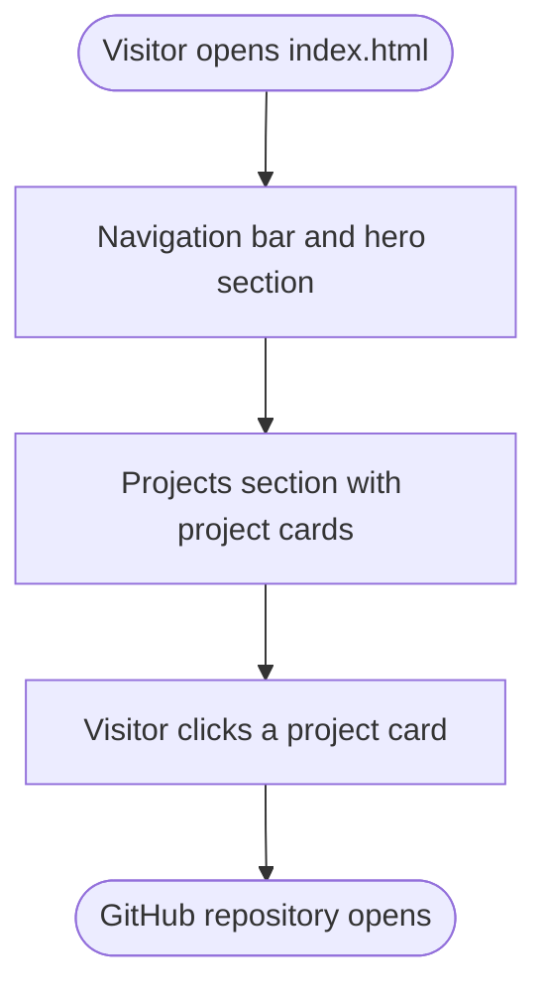

# 🚀 Personal Portfolio Website

My personal portfolio — a fast, responsive single-page site that showcases my projects.

## 📌 Overview

A static portfolio page built with HTML and Tailwind CSS. It introduces me and links to my GitHub projects, so recruiters and collaborators can see my work quickly.

## ✨ Features

* Responsive single-page layout
* Project cards linking to my GitHub repositories
* No build step — Tailwind loads from a CDN

## 🔄 Workflow

How a visitor moves through the site.



## 🛠️ Tech Stack

* Language: HTML, CSS
* Libraries: Tailwind CSS (CDN)
* Tools: Git, GitHub

## 📂 Project Structure

```
portfolio/
├── index.html
├── LICENSE
└── README.md
```

## ⚙️ Installation

1. Clone the repository:

```
git clone https://github.com/JAIMINRSOJITRA/portfolio.git
```

2. Navigate to the project:

```
cd portfolio
```

3. Open the page — no dependencies to install:

```
open index.html   # or just double-click the file
```

## ▶️ Usage

Open `index.html` in any browser. To host it for free, enable GitHub Pages (Settings → Pages → deploy from the `main` branch).

## 📊 Results / Demo

* Not deployed yet; enable GitHub Pages to publish it.

## 🧠 What I Learned

* Building responsive layouts with Tailwind utility classes
* Presenting projects clearly for a non-technical reader

## 🔮 Future Improvements

* Deploy with GitHub Pages and add the live link
* Add a resume download and a contact form
* Add project screenshots

## 🤝 Contributing

Contributions, issues, and suggestions are welcome.

## 📄 License

This project is licensed under the MIT License.

## 👨‍💻 Author

Jaimin Sojitra

* GitHub: https://github.com/JAIMINRSOJITRA
* LinkedIn: https://www.linkedin.com/in/jaimin-sojitra-4683a1277/
